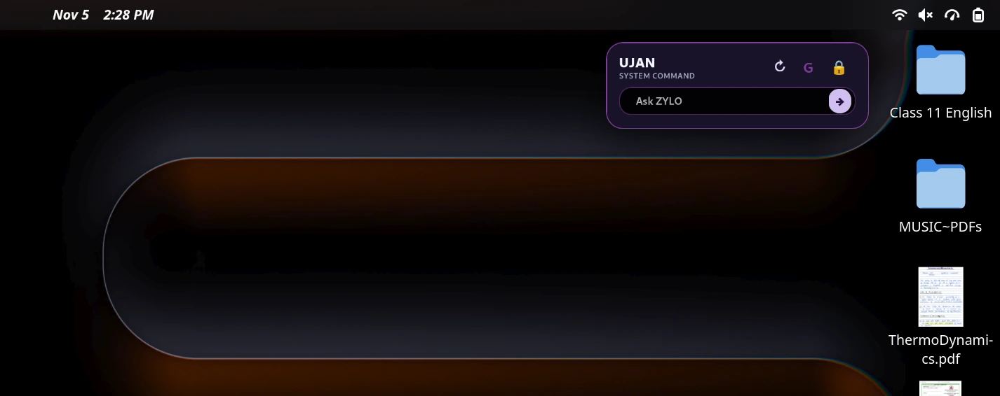
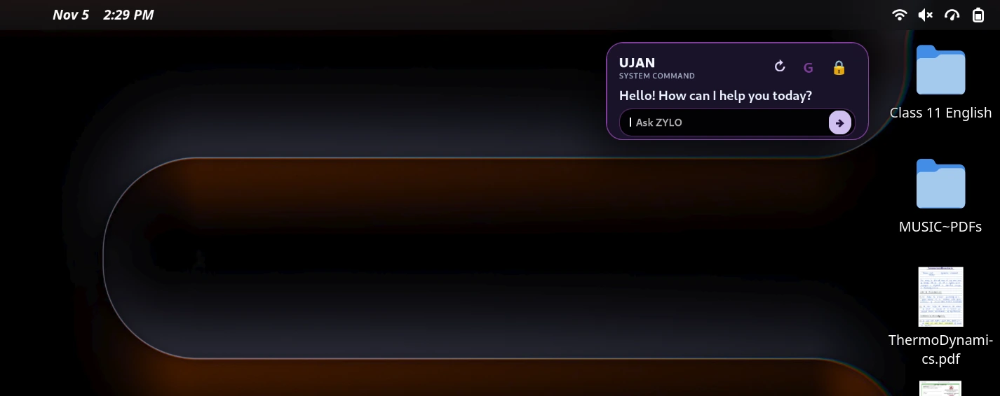
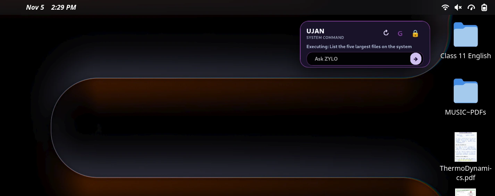

# ZYLO Desktop Assistant

ZYLO is a desktop assistant for Fedora Workstation. Its compact glass-style panel runs as a GNOME Shell extension on the desktop, while a separate launcher handles first-time setup and later changes to your profile, API keys, and accent color.

<p align="center">
  <strong>NVIDIA NIM · Groq · Tavily web search · Fedora GNOME</strong><br>
  A small desktop surface for questions and workstation actions.
</p>

## Desktop screenshots

The screenshots below are from the Fedora desktop. Each is an optimized WebP image at its original **1426 × 566 px** resolution. Click an image to open its full-size version.

<p align="center">
  <a href="assets/desktop-01-idle.webp"></a><br>
  <sub><b>01 · Desktop panel</b> — ZYLO locked on the desktop, ready for a prompt.</sub>
</p>

<p align="center">
  <a href="assets/desktop-02-response.webp"></a><br>
  <sub><b>02 · Assistant response</b> — A reply expands above the compact input.</sub>
</p>

<p align="center">
  <a href="assets/desktop-03-executing.webp"></a><br>
  <sub><b>03 · Work in progress</b> — The status line explains when ZYLO is executing a workstation action.</sub>
</p>

## Features

- A native GNOME Shell panel that stays on the desktop, hides while another application is focused, and hides in GNOME Overview.
- Move by dragging the header; resize while unlocked; lock to save the panel position and dimensions across logins.
- NVIDIA NIM with `stepfun-ai/step-5-preview` by default, or Groq with `openai/gpt-oss-120b` from the provider button.
- A short local conversation history retained between requests and logins.
- Optional Tavily web search. The model can request a search for current information; returned pages and snippets are treated as untrusted context.
- Setup form for your name, NVIDIA/Groq/Tavily keys, and a custom accent color. The launcher links to each provider's key page.
- Response text clears after a duration based on response length.
- No voice recording or speech output.

## Installation options

### Fedora RPM package

Download the latest `zylo-desktop-assistant-*.noarch.rpm` from [GitHub Releases](https://github.com/UjanGuin/ZYLO-SYSTEM-COMMAND-DESKLET/releases/latest), then install it with Fedora's package manager:

```bash
sudo dnf install ./zylo-desktop-assistant-1.0.0-1.fc45.noarch.rpm
```

Open **ZYLO Desktop Assistant** from the Applications grid. The RPM installs the launcher and app files system-wide. The first launch creates a private per-user Python environment, installs the Python requirements, installs/enables the GNOME extension, and opens the setup form. Those first-run steps need an internet connection.

### Source package

The release also includes a Fedora noarch source RPM (`.src.rpm`), a portable source archive (`.tar.gz`), and `SHA256SUMS` for download verification. Download the `zylo-desktop-assistant-1.0.0.tar.gz` source archive, extract it, and run:

```bash
tar -xzf zylo-desktop-assistant-1.0.0.tar.gz
cd zylo-desktop-assistant-1.0.0
./install.sh
```

You can also clone this repository and run `./install.sh` from `step_desklet_project/`. For subsequent setup changes, open **ZYLO Desktop Assistant** again or run `./step-desklet` from the project directory. Blank key fields keep the saved value.

## First-run setup

The launcher asks for:

1. **Your name**, displayed in the panel header.
2. **Provider keys**: NVIDIA NIM is required to set up the default model. Groq is optional. Tavily is optional and is used only if the model requests web search.
3. **Accent color**, used on the panel outline, input outline, and header controls. The dark panel and lavender send button retain their appearance.

The launcher links directly to [NVIDIA API keys](https://build.nvidia.com/), [Groq API keys](https://console.groq.com/keys), and [Tavily](https://app.tavily.com/home).

## Using the desktop panel

- Drag the header to move the panel while unlocked.
- Click the lock icon to lock its position. Unlock it to move or resize; the resize control appears only while unlocked.
- Use the reload/clear icon to clear the current response.
- Click the provider icon to switch between NVIDIA NIM and Groq. A brief confirmation appears after switching.
- Enter a prompt and press Enter or the arrow button. Status text distinguishes thinking, web search, and command execution.
- Responses expand the panel and clear automatically after a word-count-based delay.

## Providers and credentials

Credentials are stored locally in `~/.config/step-desklet.env`, with permissions set to `0600`:

```dotenv
NVIDIA_API_KEY=...
GROQ_API_KEY=...
TAVILY_API_KEY=...
```

Keys are never written to the source tree. NVIDIA and Groq provide chat completions. Tavily is called only when the model selects its `search` action; if no Tavily key is configured, ZYLO reports that search needs a key.

## Local state and files

- Setup preferences: `~/.config/step-desklet/settings.json`
- Panel position, size, and lock state: `~/.config/step-desklet/layout.json`
- Recent conversation history: `~/.config/step-desklet/conversation.json`
- Selected provider: `~/.config/step-desklet/model-provider`
- Installed extension: `~/.local/share/gnome-shell/extensions/zylo-command@local`
- Per-user virtual environment and request bridge: `~/.local/share/zylo-system-command-desklet`

The extension source is in `step_desklet_project/gnome_extension/`. `extension_bridge.py` passes requests to the Python worker in `step_desklet_project/step_desklet/core/worker.py`. `setup_app.py` is the configuration launcher.

## Updating, checking, and uninstalling

To inspect extension state:

```bash
gnome-extensions info zylo-command@local
```

To remove the RPM package:

```bash
sudo dnf remove zylo-desktop-assistant
```

To remove the per-user extension and runtime as well, run `./uninstall.sh` from the source package. It preserves your settings, conversation history, layout, and API keys in `~/.config`.

## Security

ZYLO can run shell commands as your logged-in user. Review prompts and results carefully, particularly for deletion, system changes, or elevated privileges. Treat web search results as external input rather than instructions. Protect `~/.config/step-desklet.env`; do not commit it or paste its contents into public issues.

## License

MIT. See [LICENSE](LICENSE).
